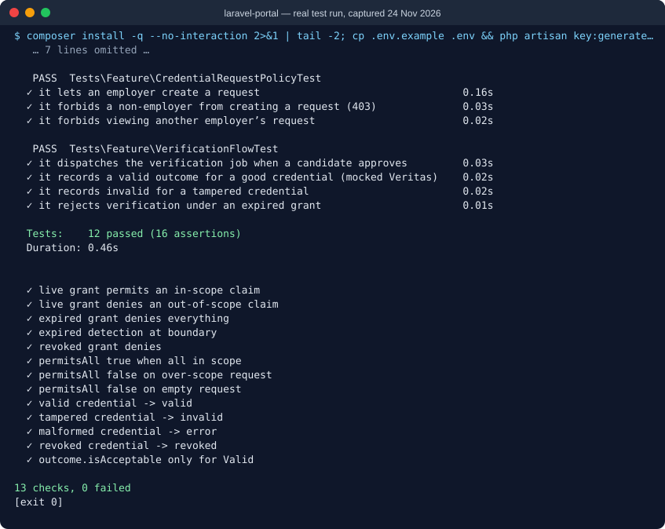

# Employer Portal (Laravel) — manual

*One page, eight blocks. Every figure here comes from this repository's own tests and README.*

## 1. Claim
Employers request credentials, candidates grant scoped, time-limited access, and verification runs on a queue through a swappable Veritas client. The full Pest suite passes 12/12, and the framework-independent domain runner passes 13/13.

## 2. What it is
A Laravel application where an employer asks to verify a candidate's credential, the candidate approves a limited share, and the portal checks it with the Veritas service.

## 3. Demo
Capture to record: `php artisan test` green (12 passed).


*Real output from this repository's own tests, captured 24 Nov 2026.*

## 4. Run it yourself
**Prerequisites:** PHP 8 and Composer (needs Packagist access).

```bash
php tests/Unit/run_domain_tests.php
composer install
cp .env.example .env && php artisan key:generate
php artisan migrate --seed
php artisan test
```

## 5. What you will see
`php artisan test` reports 12 passed (16 assertions), covering the domain, policy (403), verification flow and queue. The plain-PHP domain runner reports 13/13.

## 6. 30-second talking point
> The bug-prone part, who can see what and for how long, lives in plain PHP outside the framework, so it is tested directly. Laravel handles policies, queues and views around it.

## 7. Scope and limits
- The full Pest suite needs `composer install` (Packagist access). Its first real run (24 Nov 2026) exposed a missing base `users` migration and `storage/` skeleton, both now included.
- This repo is the application layer for a Laravel 12 project.

## 8. Links
[Repository](https://github.com/fhionnghaile/laravel-portal) · [Write-up](https://padraigfhionnghaile.com/work/laravel-portal/) · [README](README.md)
